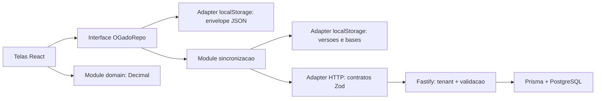

# Parecer de arquitetura e desempenho — 19/10/2026

Escopo: revisão Spec independente segundo `.claude/agents/spec-architect.md` e `explorer.md`; vocabulário das skills `.claude/skills/codebase-design/SKILL.md` e `.claude/skills/improve-codebase-architecture/SKILL.md`. O pedido explícito de Markdown prevaleceu sobre a sugestão de HTML da skill. Esta frente não modificou código de produção, dado real, serviço externo ou regra de negócio. Base inicial: commit `912e38f` mais alterações locais preexistentes, incluindo a variante de cabeças inteiras.

## Parecer

A organização atual é adequada à v1: monorepo, domínio puro compartilhado, contratos Zod e persistência PostgreSQL. Não há evidência para trocar a stack ou separar mais processos. As prioridades são integridade do armazenamento local, reprodutibilidade dos cenários, coerência entre contratos e consumidor e redução do trabalho proporcional ao histórico inteiro.

Os microbenchmarks locais mostram cálculo isolado de recria rápido, mas identificam crescimento relevante no resumo de milhares de lotes e custo quadrático nos selos de melhor cenário. Eles não comprovam o p95 HTTP, a abertura a frio do PWA, o desempenho de IndexedDB ou a experiência de um celular médio.

## Fontes e método

Lidos: `CLAUDE.md`, `GLOSSARY.md`, `docs/sdd/constitution.md`, `docs/sdd/spec-v1.md`, `docs/sdd/traceability.md`, os três documentos de `docs/negocio`, ADRs 0002, 0003, 0007, 0008, 0012, 0013 e 0014; histórico recente; domínio, contratos, repositórios, sincronização, telas e CI. A exploração priorizou os módulos de autenticação, sincronização e recria, recorrentes nos commits recentes.

Os benchmarks exercitam interfaces reais do domínio e do frontend com adaptadores em memória. Não se abriu navegador nem se iniciou servidor nesta frente. O relatório principal agrega a execução das suítes, cobertura, segurança, build e E2E.

Reprodução, a partir da raiz do repositório:

```powershell
Push-Location apps/api
node node_modules/tsx/dist/cli.mjs ../../.scratch/auditoria-2026-10-19/performance.ts
Pop-Location
```

O `tsx` já estava instalado. No sandbox, a consulta de perfil do Windows falhou com `uv_os_get_passwd ENOMEM`; a execução dos mesmos cálculos locais ocorreu fora desse sandbox após aprovação automática. Houve compilação e testes concorrentes no computador: os resultados são diagnósticos, não um orçamento de latência certificado. Repetir isoladamente no hardware alvo antes de estabelecer um gate.

Evidências: [`performance-resultados.json`](evidencias/performance-resultados.json), [`performance-regressoes.json`](evidencias/performance-regressoes.json), [`performance-execucao.log`](evidencias/performance-execucao.log). Script: [performance.ts](../../../.scratch/auditoria-2026-10-19/performance.ts). Para repetir somente as reproduções leves e recuperar os benchmarks parciais do log existente, definir `$env:AUDIT_SKIP_BENCHMARKS='1'` antes do comando.

## Arquitetura atual



Pontos preserváveis:

- O module de cálculo tem boa depth: a interface `calcularRecria` concentra regras, nulidade, variantes e custos sem I/O, proporcionando leverage para cliente e testes (ADR-0002/0003).
- A interface de repositório e os adapters injetáveis concentram locality no armazenamento e na sincronização. São seams reais: adapters de navegador e memória já existem.
- O servidor usa atualização condicionada por versão e fazenda e mantém tombstones; PostgreSQL possui índices por fazenda/atualização e unicidade do número do lote.
- Cenários persistem resultados decimais como texto e mantêm snapshots, evitando arredondamento intermediário de resultados derivados.

## Achados e ações priorizadas

### ARQ-01 — P1 — Escrita de duas abas pode perder um lançamento offline

**Evidência:** `apps/web/lib/repo/local-repo.ts:178`, `:247`, `:253`, `:277`, `:334`. Cada instância carrega seu próprio envelope, mantém cópia em memória e regrava o documento inteiro. Não há reconciliação via evento `storage`, coordenação entre abas ou transação por entidade. A reprodução usa duas instâncias compartilhando um Storage: ambas carregam vazio, A cria um lote e B cria outro; reabrir recupera só um lote. O outro só pode sobreviver se a aba A permanecer aberta e sincronizar depois. Não houve teste de corrida real em navegador nesta frente; o comportamento do adapter é reproduzido diretamente.

**Impacto:** fechar/recarregar a aba A offline remove da persistência um lançamento que a pessoa havia salvo. A interface promete persistência e integridade offline (RF-073, RNF-017).

**Recomendação Strong:** aprofundar o module de persistência local sob a interface já consumida pelas telas: transações por entidade, fila de envio atômica e coordenação entre abas. IndexedDB atende a decisão ADR-0007; a seleção de Dexie deve ser confirmada na implementação. O seam permanece no repositório; adapters de memória e navegador continuam validando a mesma interface. A depth adicional aumenta leverage em todas as telas e locality da integridade. Pelo deletion test, remover esse module espalharia a coordenação por cada chamador, portanto ele é justificado.

**Custo/validação:** médio, estimativa indicativa de 3–5 dias incluindo migração e testes. Reproduzir duas abas offline gravando simultaneamente e em sequência, recarga imediata, queda entre gravação e fila, cota cheia, migração preservando IDs, logout e contas distintas. Não remover tombstones antes de definir a janela de reconciliação dos aparelhos.

### ARQ-02 — P1 — Contrato aceita cenário que impede a sincronização

**Evidência:** `packages/contracts/src/dados.ts:132`, `:149`, `:154`; `apps/api/src/repositories/cenario-repository.ts:43`; `apps/web/lib/sync/mappers.ts:95`; `apps/web/lib/sync/engine.ts:286`. Os mapas genéricos aceitam objetos vazios para entradas, variantes, parâmetros e resultado. O adapter servidor grava esses mapas. O adapter cliente exige chaves específicas e retorna `null`; ao adotar a entidade, o motor encerra a rodada com `erro`.

**Impacto:** um payload tecnicamente aceito pode produzir um cenário ilegível que bloqueia a reconciliação de cenários dessa fazenda nas rodadas seguintes. A reprodução local verifica aceitação Zod, conversão nula e resultado `erro` do motor. Não foi enviado payload malformado a serviço real.

**Recomendação Strong:** aprofundar o module de contratos de Cenário com uma interface que descreva o snapshot completo e sua versão. A mesma interface deve ser o test surface dos adapters servidor/cliente; validar chaves, tipos, variantes e formato decimal sem depender de guardas divergentes. Concentrar compatibilidade e quarentena de itens antigos mantém locality e leverage; não criar um módulo de validação para cada campo. O deletion test favorece manter o contrato compartilhado porque sua remoção duplicaria conhecimento entre chamadores. A revalidação semântica pelo domínio prevista em ADR-0007 §4 deve ser implementada com a versão de fórmula registrada, preservando o snapshot histórico.

**Custo/validação:** médio, 2–3 dias. Contrato rejeita mapas vazios/resultado inconsistente; adapters aceitam todos os payloads válidos; dados legados inválidos recebem erro recuperável por item e não interrompem itens válidos. Validar offline antigo e novo, incluindo migração de contratos.

### ARQ-03 — P1 — Snapshot perde uma variante que altera o resultado

**Evidência:** `apps/web/lib/recria.ts:42` força `cabecasInteiras: true`; `packages/domain/src/recria.ts:192` aplica `ceil()` antes dos demais cálculos; `:259` retorna apenas `lotacaoInicial` e `faturamentoBruto`. `apps/web/lib/cenarios.ts:53` copia essas variantes incompletas ao salvar.

**Impacto:** as mesmas entradas, parâmetros e variantes registrados no cenário não reproduzem seu resultado. A fórmula exata da planilha calcula cerca de 59,773 cabeças; a UI calcula 60. No caso reproduzido, o snapshot registra líquido de R$ 103.307,60; o replay de seus próprios parâmetros/variantes dá R$ 102.408,0529717. As suítes de paridade do domínio podem passar enquanto o comportamento da UI difere da planilha. A própria suíte de UI escolhe a variante `cabecasInteiras`, o que não prova conformidade com o ouro independente.

**Recomendação Strong:** aprofundar o module de Cenário para registrar a variante completa e a versão do cálculo na interface do snapshot. O seam de salvar/reabrir deve testar replay, com adapters cliente e servidor usando o mesmo contrato. Isso dá locality ao histórico e leverage à exportação/comparação. O deletion test rejeita deixar essa informação implícita nos chamadores. A alteração de regra para cabeças inteiras precisa estar explicitamente numerada na spec e justificada por ADR ou decisão do dono; esta auditoria não decidiu qual regra usar (constituição §1/2/4, ADR-0003/0008/0014).

**Custo/validação:** pequeno a médio, 1–2 dias após confirmação documental da regra. Caso com cabeças fracionárias deve salvar, serializar, sincronizar, reabrir e reproduzir todos os resultados, com ouro independente para cada variante e compatibilidade de cenários antigos.

### ARQ-04 — P2 — Selo de melhor cenário tem custo quadrático

**Evidência:** `apps/web/components/CenariosScreen.tsx:252`, `:261`, `:314`, `:324`; `apps/web/lib/cenarios.ts:69`, `:79`. Cada cartão chama `ehMelhor`, que percorre todos os cenários e instancia valores Decimal. Uma renderização da lista repete a busca N vezes; existem árvores de lista/grade. O benchmark mede só uma passagem dos selos, sem render React.

**Recomendação Strong:** calcular o maior líquido uma vez por conjunto de cenários e reutilizá-lo na interface que apresenta os itens; conservar a comparação Decimal. Isso aumenta a depth do module de apresentação sem criar seam ou adapter novo. Locality fica no cálculo da seleção e leverage alcança lista, grade e comparação. Pelo deletion test, um wrapper que apenas repassa `ehMelhor` não resolveria o custo; a alteração precisa retirar a varredura repetida.

**Custo/validação:** pequeno, horas. Testar empate, nulos, exclusão e filtro; medir novamente 100/1.000/5.000 cenários, além de renderização no navegador. Paginação/virtualização devem vir depois de remover o custo quadrático, se o volume real exigir.

### ARQ-05 — P2 — Pull integral, serialização integral e fila implícita limitam crescimento

**Evidência:** `apps/web/lib/sync/data-client.ts:134`, `:141` recebe todos os lotes/cenários incluindo excluídos; `apps/web/lib/sync/engine.ts:280` reconcilia a lista completa e serializa bases; `apps/api/src/repositories/lote-repository.ts:40` e `cenario-repository.ts:26` não têm paginação; `apps/web/lib/repo/local-repo.ts:253` regrava todo o envelope. A interface pública de listagem não possui cursor de mudanças, embora ADR-0007 §5 o defina. Cada novo item local é enviado em requisição sequencial: latência de rede e rate limit também limitam drenagem de filas extensas.

**Recomendação Worth exploring:** aprofundar o module de sincronização com cursor estável `(updatedAt,id)`, páginas limitadas, confirmação durável do cursor e fila transacional por mutação. Preservar idempotência e concorrência otimista. O seam deve concentrar retomada, tombstones e contratos antigos; os adapters HTTP e memória já variam de fato. A interface menor para os chamadores aumenta leverage, enquanto concentrar checkpoint e migração melhora locality. Pelo deletion test, evitar novos wrappers que só repassem `listar` e `salvar`: o ganho vem de esconder o protocolo e reduzir trabalho efetivo.

**Custo/validação:** médio a alto, 3–6 dias; depende de ARQ-01/02. Testar duas atualizações com mesmo timestamp, paginação durante escrita, interrupção antes/depois do checkpoint, sessão expirada, exclusão, idempotência e reenvio. Comparar bytes transferidos e tempo de sincronizar zero/um/muitos itens. Não há proposta de reabrir ADR-0002 ou introduzir mensageria externa.

### ARQ-06 — P2 — Decisão de conflito e lotação inicial não estão coerentes com as fontes da spec

**Evidência:** `docs/sincronizacao-automatica.md:5` e `apps/web/lib/sync/engine.ts:323` aplicam mesclagem automática e exclusão prevalente; `docs/adr/0007-pwa-instalavel-e-offline-first.md` §6 e RF-076 ainda exigem escolha explícita. `docs/sdd/traceability.md:19` continua afirmando conflito manual. ADR-0014 §3 exige `areaPastavel` para simulador novo e ao limpar, mas `apps/web/lib/repo/local-repo.ts:198` e `:375` usam `fixa80`. A rastreabilidade ainda descreve valores de ouro da UI que foram alterados pelo arredondamento de cabeças.

**Recomendação Strong:** registrar as decisões reais já autorizadas pelo dono em ADR/requisitos e alinhar o module de Cenário e seus testes à decisão vigente. Não restaurar diálogo ou alterar fórmula por interpretação desta auditoria. O seam de comportamento de sincronização deve ter uma única interface documental/testável; adapters antigos precisam de compatibilidade. Essa depth documental fornece leverage aos testes e locality às regras; pelo deletion test, remover a tabela de rastreabilidade sem substituir sua função espalharia o conhecimento pelos tickets.

**Custo/validação:** pequeno para reconciliação documental, 0,5–1 dia; qualquer mudança de regra exige decisão explícita. Verificar requisito → teste comportamental → código, incluindo inicialização/limpeza reais sem helper que sobrescreva a variante.

### ARQ-07 — P2 — Precisão Decimal de Compra/Venda depende de estado global

**Evidência:** `packages/domain/src/compra-venda.ts:7` e `packages/domain/src/index.ts:4` chamam `Decimal.set()` no construtor compartilhado/exportado. Outro consumidor pode mudar a precisão em execução e alterar os cálculos posteriores. Recria já se protege com `DecimalBase.clone({ precision: 28 })` em `recria.ts:7`.

**Recomendação Strong:** aplicar o mesmo isolamento do construtor aos modules numéricos e oferecer uma interface que preserve a precisão da regra de negócio. Esse seam é interno ao domínio; não precisa de adapter novo. A depth protege invariantes sem exigir configuração a cada chamador, com leverage para todas as fórmulas e locality para ajustes de precisão. O deletion test favorece manter essa proteção em um ponto compartilhado em vez de repetida por fórmula.

**Custo/validação:** pequeno, horas a 1 dia. Repetir ouro antes/depois de um consumidor alterar `Decimal.precision`, incluindo ordem de import, operações de formatar e paralelismo de testes. Não alterar casas persistidas nem tolerância sem ADR-0003.

### ARQ-08 — P2/P3 — Medições contínuas e índices precisam acompanhar consultas reais

**Evidência:** `.github/workflows/ci.yml` executa tipos/lint/unidade/cobertura/paridade/build; não executa E2E, axe, orçamento de bundle ou benchmark de latência. `packages/db/prisma/schema.prisma:143`, `:144`, `:165`, `:166`, `:197` já possui índices úteis. `HistoricoSync` lista por fazenda e data em `apps/api/src/repositories/historico-sync-repository.ts:28`, enquanto seu índice começa por `(fazendaId,entidadeId,criadoEm)`: a listagem sem entidade pode exigir ordenação adicional. Não houve `EXPLAIN ANALYZE` com PostgreSQL nesta frente.

**Recomendação Worth exploring:** manter os modules atuais; tornar explícita a interface de SLO de cálculo, leitura local e HTTP. O seam dos adapters PostgreSQL e navegador deve ser medido com dados sintéticos representativos; aceitar índices novos somente com plano e ganho observado. Isso mantém locality da medição e leverage em mudanças futuras. Pelo deletion test, um module de observabilidade que só renomeasse logs não acrescentaria depth; preferir request ID, duração, erro por classe, tamanho de fila, duração de sync e motivo de recusa sem conteúdo pessoal. A inclusão de índice composto para histórico global é condicional à medição, não uma falha confirmada.

**Custo/validação:** médio, 2–4 dias para gates e orçamento; índices, horas após plano real. Rodar E2E local/offline em CI, teste automatizado de acessibilidade, carga HTTP em ambiente descartável com p95/p99 e erros, teste PWA em dispositivo médio, bundle por rota. Medir RNF-002/005/006/008/013/017 separadamente. Não inferir throughput de usuários pelos microbenchmarks abaixo.

## Banco de dados e escala

O tenant aparece nos filtros de listagem e atualização, há constraints de unicidade e exclusões mantêm tombstone. Os índices existentes permitem iniciar o pull incremental sem reestruturação ampla. A constraint `(fazendaId,tipo,numero)` protege o sequencial de lote; a criação faz max+1 e repete até cinco vezes (`lote-repository.ts:69`). Sob inserções concorrentes intensas pode esgotar tentativas; isso é risco condicional, não falha medida. Antes de trocar por contador transacional, executar teste concorrente no PostgreSQL descartável, observar colisões e taxa de erro.

Definir retenção de histórico e tombstones requer política de sincronização dos aparelhos e política de dados. Não apagar silenciosamente para melhorar latência. O estado de sincronização guarda `bases` completas além do envelope principal, duplicando parte dos dados no aparelho; tamanhos do benchmark de lotes não incluem esse segundo documento, histórico, caches do PWA ou string/objeto em memória.

## Resultados de desempenho

Ambiente: Windows x64 10.0.26200, Intel Core i7-1165G7 2,80 GHz, 8 CPUs lógicas, 7,73 GiB RAM, Node v22.23.2, V8 12.4.254.21. Durante a coleta inicial o executor principal observou aproximadamente 0,15 GiB de RAM livre enquanto builds/testes concorriam. Por pressão de recursos, o benchmark foi interrompido durante 5.000 cenários. Os 13 casos completos abaixo foram recuperados do log; os três casos restantes foram **concluídos separadamente na retomada de 20/10/2026**, descrita adiante. Os artefatos originais continuam preservados como registro da primeira coleta.

`memoryStorage` usa Map: inclui a serialização/parse reais do module, mas exclui disco/IPC do navegador. p50/p95 de casos com batch são percentis da média por operação no lote, não cauda de interação individual. Percentil p95 com 20 amostras aproxima-se do máximo: serve para diagnóstico, não para SLO.

| Interface / volume | Operações medidas | Warmup | p50 (ms) | p95 (ms) | Operações/s |
|---|---:|---:|---:|---:|---:|
| Domínio recria, ouro | 20.000 (200 × 100) | 1.000 | 0,127 | 0,204 | 7.594 |
| Snapshot de recria pela interface web | 5.000 (100 × 50) | 500 | 0,211 | 0,587 | 3.956 |
| Resumo Negócios, 100 lotes | 60 | 10 | 3,830 | 13,092 | 155,64 |
| Leitura fria repositório/Map, 100 lotes | 60 | 10 | 0,752 | 1,273 | 1.220,85 |
| Editar + serializar/Map, 100 lotes | 60 | 10 | 0,450 | 0,777 | 1.894,32 |
| Resumo Negócios, 1.000 lotes | 60 | 10 | 35,460 | 69,968 | 25,86 |
| Leitura fria repositório/Map, 1.000 lotes | 60 | 10 | 5,998 | 11,277 | 144,58 |
| Editar + serializar/Map, 1.000 lotes | 60 | 10 | 4,577 | 11,973 | 194,87 |
| Resumo Negócios, 10.000 lotes | 30 | 10 | 475,729 | 980,985 | 1,78 |
| Leitura fria repositório/Map, 10.000 lotes | 60 | 10 | 56,343 | 103,857 | 16,70 |
| Editar + serializar/Map, 10.000 lotes | 60 | 10 | 40,832 | 73,423 | 23,43 |
| Selos melhor cenário, 100 cenários | 20 | 3 | 9,365 | 15,396 | 98,30 |
| Selos melhor cenário, 1.000 cenários | 20 | 3 | 1.904,880 | 2.487,782 | 0,57 |

O envelope com 10.000 lotes tem 3.104.282 bytes UTF-8, ou 6.208.564 bytes de caracteres UTF-16; essa contagem não determina a política de cota do navegador. Não inclui `bases`, estado de sync, cache nem objetos em memória. Não foi produzido heap profile.

Resultados comportamentais leves, concluídos após interromper o benchmark:

| Reprodução local | Resultado observado |
|---|---|
| Duas instâncias/abas, cada uma cria um lote offline | Cada aba mostra 1 lote; persistência final tem só 1, quando deveria preservar 2 |
| Cenário com mapas vazios | Zod aceita; mapper retorna `null`; motor retorna `erro` |
| Replay do snapshot da UI | 60 cabeças / líquido 103307.6 registrados; 59,773… / 102408,0529717… ao reaplicar variantes salvas |
| Precisão global alterada por consumidor | Total de compra muda de 122535,833333… para 122530 com precisão 5; Recria possui clone isolado |

As medições iniciais de latência foram coletadas sob forte pressão do host e devem ser repetidas isoladamente para comparação controlada. A complexidade quadrática e as quatro divergências comportamentais são verificáveis sem extrapolar esses números.

### Retomada concluída — 20/10/2026

Foram executados somente os três casos interrompidos, sequencialmente, sem build nem outra suíte da auditoria concorrente. Mesmo computador, cerca de 1,31 GiB livres no início e 1,27 GiB no fim; duração de processo 110,63 s, exit code 0. A diferença de pressão de recursos impede comparação quantitativa rigorosa com a coleta inicial; o custo quadrático permanece evidenciado pelo algoritmo e pelo tempo absoluto observado.

| Interface / volume | Amostras | Warmup | p50 (ms) | p95 / máximo (ms) | Operações/s |
|---|---:|---:|---:|---:|---:|
| Selos melhor cenário, 5.000 cenários | 5 | 1 | 16.560,654 | 19.920,630 | 0,058 |
| Sync sem alterações / memória, 1.000 lotes | 30 | 5 | 8,768 | 12,234 | 109,29 |
| Sync sem alterações / memória, 10.000 lotes | 30 | 5 | 88,571 | 126,928 | 10,66 |

Com cinco amostras, o p95 da primeira linha é o máximo observado e não estima uma cauda estável. A sincronização usa o motor real, mas adapters HTTP/Storage em memória; mede pull de lotes já sincronizados, reconciliação e serialização, sem rede, disco, PostgreSQL ou envio de pendências. Uma validação posterior, separada dos tempos, confirmou retorno `ok` e preservação de 1.000/10.000 lotes, versões e bases. Assim, a medição não corresponde a uma falha rápida silenciosa.

Evidências: [resultados da retomada](evidencias/performance-retomada.json), [comando e duração](evidencias/performance-retomada-execucao.json), [log](evidencias/performance-retomada-execucao.txt), [validação do caminho de sucesso](evidencias/performance-sync-validacao.json). Total: **16 microbenchmarks completos**, além dos testes HTTP do parecer principal.

Reprodução da retomada, na raiz:

```powershell
$env:AUDIT_BENCHMARKS_REMAINING='1'
node apps/api/node_modules/tsx/dist/cli.mjs .scratch/auditoria-2026-10-19/performance.ts
Remove-Item Env:AUDIT_BENCHMARKS_REMAINING
node apps/api/node_modules/tsx/dist/cli.mjs .scratch/auditoria-2026-10-19/validate-clean-sync.ts
```

## Limites do parecer

- Não é ensaio de carga real. Sem k6/HTTP/concorrência de usuários nesta frente; RNF-002 p95 HTTP <300 ms permanece dependente de medição própria.
- RNF-013 leitura <100 ms e abertura <2 s exige navegador/dispositivo alvo. A leitura Map-backed de 10.000 lotes mostra pressão de CPU, sem certificar o objetivo.
- Nenhum teste de volume SQL, failover, recuperação de backup ou plano real foi executado nesta frente. Os achados de índices e contenção estão explicitamente condicionais.
- Os adaptadores de memória reproduzem decisões de persistência e contrato, mas não substituem testes de cota, concorrência multiaba e interrupção em navegador.
- Os achados sugerem tickets e validações; não constituem autorização para trocar regra pecuária, implantar migração ou alterar termos.

## Ordem sugerida de execução

1. Resolver ARQ-02/03 e documentar ARQ-06, evitando persistir novos cenários inválidos ou irreproduzíveis.
2. Corrigir a durabilidade multiaba de ARQ-01; migrar dados preservando fila e tombstones.
3. Retirar o custo quadrático de ARQ-04, mudança pequena com ganho mensurável; isolar Decimal em ARQ-07.
4. Medir uso e volume real; implementar pull incremental e checkpoints de ARQ-05.
5. Automatizar E2E/acessibilidade e orçamentos de desempenho de ARQ-08; adicionar índices somente mediante plano real.

Decisões tomadas nesta auditoria: preservar stack e interfaces úteis; priorizar integridade e reprodutibilidade; não refatorar produção. Perguntas de negócio abertas: formalização da variante de cabeças inteiras e confirmação das decisões atuais de conflito/lotação. Próximos tickets sugeridos: os oito achados acima, associados aos RF/RN/RNF e ADRs citados.
